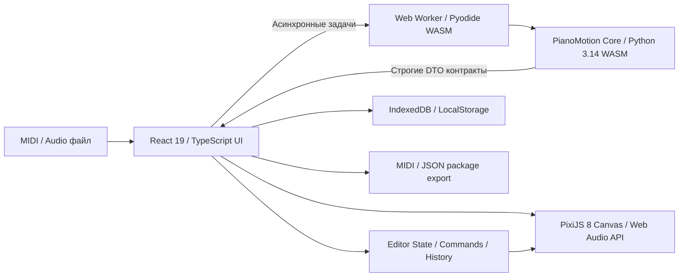

# PianoMotion Studio

Текущая локальная версия — **0.1.0-dev.13**: добавлена мультиязычная локализация интерфейса (en, cs, uk, de, es, it), унифицирован размер шрифта верхней панели до 12px, кнопки панели аппликатуры заменены иконками, стабилизировано поведение Undo при перерасчёте аппликатуры. Native TypeScript выбран по умолчанию; Python остаётся альтернативой.

Интерактивная веб-студия визуализации фортепианного исполнения, процедурной 3D-кинематики рук, расчёта эргономичной аппликатуры и синхронизации аудио.

Разработано как полностью автономное веб-приложение (Single Page Application + Web Workers + WebAssembly) без серверных зависимостей, работающее локально на устройстве пользователя.

Рабочая папка: `C:\Projects\pianomotion-studio`. Исправления R01–R14 повторного аудита от 15 октября реализованы и проверены автоматически. Ручная приёмка оборудования/прослушивания и ограничения нагрузки перечислены в [реестре исправлений](docs/AUDIT_REPAIR_PROGRESS.md); устройство интерфейса описано в [implementation record](docs/STUDIO_WORKSPACE_IMPLEMENTATION.md). Исторические отчёты M1–M8 не подтверждают текущую полную релизную готовность.

## Рабочее пространство

Встроенная библиотека, добавленная в `0.1.0-dev.6`, содержит библиотеку **163 встроенных MIDI-мелодий**. Открыть её можно на стартовом экране (**Browse built-in melodies**), через **File → Built-in melodies…** или кнопку в **Projects**. Поиск работает по названию. Выбранная мелодия открывается как отдельный редактируемый проект; сохранение не меняет оригинал библиотеки. При наличии несохранённых правок действует обычный выбор Save/Discard/Cancel.

Источник — только `builtin_melodies/midi/`; остальные форматы из пользовательской папки не включаются. `npm run prepare:melodies` создаёт проверяемый SHA-256 каталог в генерируемой `apps/client/public/builtin-melodies/`. Команды dev/build выполняют подготовку автоматически. Production-сборка включает весь каталог в согласованный offline-набор. Для свежего checkout нужны исходные MIDI, а не копирование генерируемой папки. [Устройство и результаты проверки](docs/evidence/builtin-melodies-2026-10-16/VERIFICATION.md).

Единое рабочее поле показывает ноты, все 88 клавиш и руки: Performance поддерживает PixiJS 2D и Three.js 3D, Fingering использует общую 2D-сцену. Камера 3D выбирается кнопками на широком экране и компактным селектором на узком. Режимы исполнения и редактирования сохраняют общий транспорт и музыкальные данные:

- **Performance** — воспроизведение и анимация исполнения.
- **Fingering** — выделение нот на той же сцене, назначение руки/пальца, глиссандо и исключение из исполнения. Назначения и переключатель **Auto-advance** находятся в верхней панели, только в Fingering. **Undo/Redo** доступны через меню **Edit** и клавиатурные сокращения; справка о клавишах — через **Help (?) → Keyboard shortcuts**. Отдельной строки инструментов над сценой нет. На узких окнах назначения переносятся в дополнительную строку верхней панели. Прокрутка по времени и масштаб просмотра отделены от позиции транспорта.

Меню **File** открывает MIDI и JSON-пакет, сохраняет проект в IndexedDB. Панель **Projects** содержит локальные проекты и поиск. **Inspector** открывает параметры сцены, пианиста, аудиозаписи и диагностику; подробные настройки и анатомия доступны на отдельных экранах. Панели выезжают поверх сцены; на широком экране одну можно закрепить. **Focus** скрывает вспомогательные панели.

Транспорт находится внизу. Закреплённый компактный статус-бар показывает операции и ошибки; нажатие открывает диагностику. Кнопка версии раскрывает описание изменений. Текущая локальная версия `0.1.0-dev.8` — предварительная сборка, без релизного тега. Версию опубликованного сайта проверяйте отдельно в его статус-баре.

В dev.7 включён **MuseScore General v0.2 (SF3)**: новые настройки используют его автоматически, без загрузки файла пользователем. **Settings → Audio → SoundFont bank** позволяет выбрать включённый банк или загрузить свой **SF2/SF3 до 1 GiB**. Существующий выбор синтезатора, MIDI или своего банка сохраняется. Ogg/Vorbis-сэмплы SF3 декодируются по требованию; весь банк не распаковывается. Банк и [полные авторские уведомления MIT](docs/licenses/MuseScore_General_License.md) включаются в согласованную offline-сборку.

SoundFont: добавлены связанные стереопары L/R и чтение банков до **1 GiB** из Blob по диапазонам. Исходный банк хранится отдельно от проекта, SHA-256 вычисляется в Worker блоками по 4 MiB. Размер файла не равен потреблению аудиокеша: общий бюджет декодирования — 256 MiB на вкладку, неактивный LRU — 64 MiB. Полный набор особенностей SF2 не заявляется; [совместимость и ограничения](docs/AUDIO_SUPPORT.md), [реализация и приёмка](docs/SOUNDFONT_STEREO_IMPLEMENTATION.md).

В dev.5 исправлены периодические паузы анимации: ограниченные окна поз запрашиваются заранее, с запасом по скорости и задержке Worker, а после подготовки плеер учитывает ручную Pause/Stop. Chrome и Edge прошли сценарии задержанного Worker и скорости 2× без буферных остановок, размеры банков 128/512/1024 MiB, реальный Nice Steinway и production offline-восстановление. Итог: 447 unit-тестов, 13 численных эталонов, typecheck/lint/build; [точные результаты и границы проверки](docs/evidence/sf2-motion-2026-10-16/VERIFICATION.md).

JSON-пакет v2 хранит исходные MIDI-байты, стабильные ID, профиль, ручные назначения и `sourceContext` (исходный namespace и геометрия клавиатуры). Импорт подготавливает и проверяет новый проект до замены текущего. Неоднозначный старый пакет или повреждённые ресурсы не должны автоматически переписывать открытый проект.

---

## Возможности

- **Математический расчёт аппликатуры**: Алгоритм динамического программирования с многофакторным штрафом за растяжку, вертикальные переходы, скрещивание рук, физическую скорость и анатомические особенности пианиста.
- **Процедурная кинематика рук**: Обратная кинематика (IK) для 23 анатомических костей каждой руки, автоматическое скрещивание рук с динамическим порядком слоёв (`layerOrder`), раскатка широких аккордов и раннее снятие нот на быстрых пассажах.
- **Стили рук**:
  - `realistic` — основной анатомический стиль с телесными поверхностями и подписями пальцев.
  - `cartoon` — телесные мультяшные руки с ногтями, суставами, рукавами и манжетами.
  - `gloves` — белые мультяшные перчатки с прострочкой на тыльной стороне ладони.
  - `robot` — футуристические металлические пластины с шарнирами и тёмными наконечниками.
  - `skeleton` — классический анатомический каркас фаланг и суставов.
  - *Мягкие динамические тени* с затуханием прозрачности и проекцией по высоте руки ($Z$).
- **Скользящий буфер кинематики (Lookahead Buffer)**:
  - Упреждающее сэмплирование поз на 4.0 секунды вперёд в фоновом воркере.
  - Плавная интерполяция между соседними позами на 60 FPS.
  - Физическая верификация касания: гарантированный контакт кончика пальца с нажатой клавишей ($Z \le 0.1$).
- **Рендеринг сцены на PixiJS 8**:
  - 88-клавишная клавиатура (A0–C8) с реалистичной и равноширинной геометрией.
  - Падающие ноты с цветовой кодировкой по рукам (левая — синяя, правая — зелёная) и отсечением невидимых объектов (viewport culling).
  - Красная полоса сукна и фон рабочей зоны рук.
- **Web Audio синтезатор и транспорт**:
  - Полифонический синтезатор с гармоническими обертонами и экспоненциальной огибающей громкости.
  - Полная поддержка педалей: Sustain (CC 64), Sostenuto (CC 66), Soft (CC 67).
  - Точный планировщик событий lookahead на часах AudioContext без дрифта времени.
  - Регулировка скорости (0.25x – 2.0x), громкости и отрицательного затакта (lead-in до -2.0 с).
- **Интерактивный редактор аппликатуры на общей сцене**:
  - Ноты используют ту же геометрию клавиш, что и исполнение; поддерживаются выделение и просмотр по времени.
  - **Auto-advance**: после назначения пальца выделяется следующая нота по времени (в аккорде — по высоте). Назначение руки, очистка и исключение ноты не переключают выделение. По умолчанию выключен.
  - История Undo/Redo до 50 шагов сохраняется при переключении режима.
  - Анализ эргономики и сложности произведения (шкалы от Beginner до Virtuoso).
- **Анатомические профили пианиста**:
  - Регулировка длин фаланг (mc1–5, pp1–5, mp2–5, dp1–5) и ширины запястья.
  - Настройки кинематического поведения (гладкость, скрещивание, раскатка, избегание чёрных клавиш).
  - Пресеты: *Default*, *Small Hands (детские/небольшие руки)*, *Virtuoso (большой охват)*, *Left-Hand Lead*.
- **Синхронизация с внешними аудиозаписями**:
  - Загрузка и декодирование аудио в форматах WAV, MP3, OGG, FLAC (до 100 МБ).
  - Генерация 5-миллисекундного пикового вейвформа (`WaveformCanvas`).
  - Тонкий сдвиг смещения (10 мс шаг при зажатом Shift) для идеального совмещения с MIDI.
- **Экспорт**:
  - JSON-пакеты и MIDI с аппликатурой доступны через меню Export.
  - Видеоэкспорт MP4 (H.264/AAC) и WebM (VP9/Opus, затем VP8 при необходимости) через WebCodecs и Mediabunny 1.61.4. Кодеки проверяются до запуска; недоступный вариант объясняется в диалоге.
  - По умолчанию 1080p/30 FPS, полный проект, скорость 1× и хвост 1,5 с. Отдельный Worker и копия исходных данных защищают экспорт от правок в студии. Основной вывод — потоковая запись файла, резервный Blob ограничен 128 MiB.
  - SoundFont и Web MIDI подготавливаются асинхронно; индикатор отражает фактически активный выход. Нужны пользовательский SF2 или разрешение на реальное MIDI-устройство. Результаты автоматических и аппаратных проверок различаются в реестре.
- **Progressive Web App (PWA) и локальное хранение**:
  - Установка как отдельное настольное или мобильное приложение (`manifest.webmanifest`).
  - В production Service Worker хранит согласованные версии `releases/<buildId>/`, проверяет SHA-256 ресурсов и публикует кеш только после полного завершения. В dev SW не регистрируется. Обновление требует commit текущего проекта и неизменившейся revision.
  - Локальное хранение в IndexedDB (`handthesia_db` v2) с автосохранением сессий и защитой от переполнения квоты.
  - Безопасность: защита от path traversal, prototype pollution и строгий CSP.

---

## Архитектура

Приложение построено по модульной шинной архитектуре:



---

## Структура проекта

```text
pianomotion-studio/
├── apps/
│   └── client/                # Главное React-приложение
│       ├── src/
│       │   ├── audio/         # Web Audio синтезатор, транспорт, синхронизация
│       │   ├── editor/        # Команды, история, сложность, bridge к общей сцене
│       │   ├── studio/        # Оболочка, панели, режимы, транспорт и компоновка
│       │   ├── export/        # Видеоэкспортёр, офлайн аудио-рендерер, WAV кодировщик
│       │   ├── player/        # Контроллер воспроизведения и плеер
│       │   ├── profiles/      # Анатомические профили и параметры пианиста
│       │   ├── pwa/           # Регистрация и управление Service Worker
│       │   ├── render/        # PixiJS 8: клавиши, ноты, руки, скины, тени
│       │   ├── settings/      # Настройки приложения
│       │   ├── storage/       # IndexedDB v2, валидация файлов, пакетный экспорт
│       │   └── workers/       # Pyodide Web Worker клиент и обработчики
│       ├── public/            # PWA манифест, иконки, Pyodide WASM рантайм, фикстуры
│       └── dist/              # Готовая production-сборка
├── packages/
│   └── contracts/             # Строгие DTO схемы и Zod-валидаторы (@handthesia/contracts)
├── python-core/               # Численное ядро для WebAssembly (handthesia_core)
├── tests/
│   ├── browser/               # Playwright Chromium, реальные Worker-сценарии
│   ├── unit/                  # Дополнительные Vitest тесты (также рядом с src)
│   └── fixtures/              # Эталонные фикстуры и валидационные данные
├── tools/                     # Скрипты сборки, упаковки рантайма и CI
├── docs/                      # Техническая документация, отчёты и спецификации
├── package.json               # Корневой npm workspaces манифест
└── vitest.config.ts / playwright.config.ts
```

---

## Запуск и разработка

### Требования
- **Node.js** версии 20.19+ или 22.12+ (требование установленного Vite).
- **npm** версии 10+.

### Установка зависимостей
```bash
npm ci
```

### Запуск dev-сервера
```bash
npm run dev
```
Для фиксированного локального адреса: `npm run dev -- --host 127.0.0.1 --port 5176 --strictPort`. Адрес: [127.0.0.1:5176](http://127.0.0.1:5176/). В текущей локальной среде5173 занят старой копией из `pygame-piano-animator/web`. Если порт занят, проверьте существующий сервер; не завершайте неизвестный процесс.

---

## Тестирование и верификация

Проект покрыт автоматическими тестами:

```bash
# Проверка типов TypeScript:
npm run typecheck

# Линтинг кода (ESLint):
npm run lint

# Запуск полного набора unit-тестов:
npm run test:unit

# Запуск браузерных тестов (Playwright):
npm run test:browser

# Отдельное тестовое Python-окружение (.venv-test), без изменения desktop .venv:
npm run test:python

# Все браузерные группы последовательно, после production build:
npm run build
npm run test:browser:all

# Полный автоматический CI-пайплайн:
npm run ci
```

Для Python-проверок создайте `.venv-test` на Python 3.14 и установите `python-core/requirements-test.txt`; runner использует это окружение либо `PIANOMOTION_TEST_PYTHON`. Сравнение геометрии с desktop требует соседний checkout `../pygame-piano-animator` с модулем `common` и pygame в тестовом окружении. Без них эта отдельная проверка явно пропускается и не считается принятой. В текущем локальном прогоне все 28 Python-тестов прошли без пропусков; CI получает desktop reference на закреплённом коммите из workflow.

Группы `test:worker`, `test:audio`, `test:offline` и `test:media` выделены отдельно от UI. Тяжёлые группы не запускать одновременно. Для Windows Chrome или Edge задайте `PIANOMOTION_BROWSER_CHANNEL=chrome` либо `msedge` в окружении соответствующего запуска. GitHub workflow описывает обе проверки; его наличие не означает, что удалённый CI уже выполнен. Актуальные локальные результаты и ограничения находятся в [реестре](docs/AUDIT_REPAIR_PROGRESS.md).

---

## Сборка и упаковка

### Сборка production-бандла
```bash
npm run build
```
Собранные статические файлы будут помещены в директорию `apps/client/dist/`.

### Публикация на GitHub Pages
Опубликованный сайт: [shafranek-js.github.io/pianomotion-studio](https://shafranek-js.github.io/pianomotion-studio/). Состояние текущей публикации проверяйте в [Deploy GitHub Pages](https://github.com/shafranek-js/pianomotion-studio/actions/workflows/deploy-pages.yml) и по версии в статус-баре сайта. Сборка использует базовый путь `/pianomotion-studio/`.

`.github/workflows/deploy-pages.yml` запускает typecheck, lint, unit-тесты и production build при push в `main` или ручном запуске workflow, затем передаёт `apps/client/dist/` в Pages. Публикация выполняется только для `main` при включённой GitHub Pages и Actions variable `PAGES_ENABLED=true`. Windows-проверки Chrome и Edge запускаются отдельно через `verify.yml`.

### Создание автономного zip-архива
```bash
npm run archive
```
Формирует архив исходного проекта `pianomotion-studio.zip` рядом с checkout (без `node_modules` и временных файлов). Для запуска перенесённого проекта нужны установка зависимостей и доступный Node.js; для статического хостинга используется содержимое `apps/client/dist/`.
