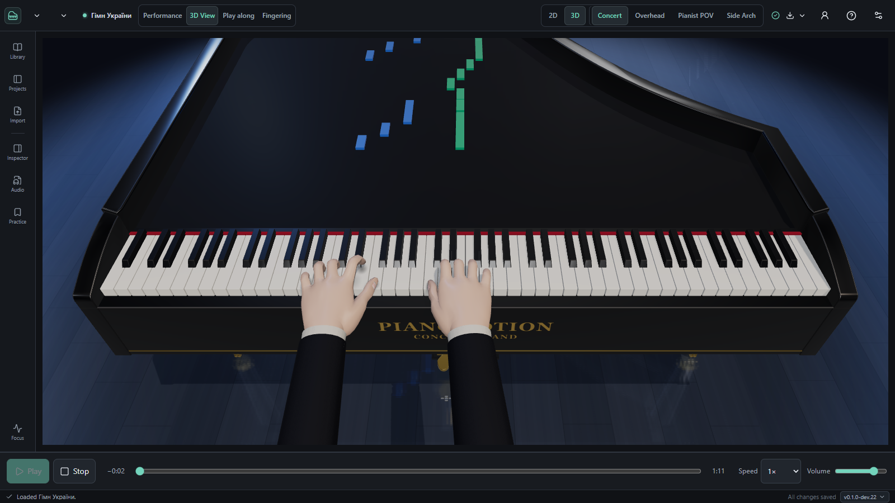
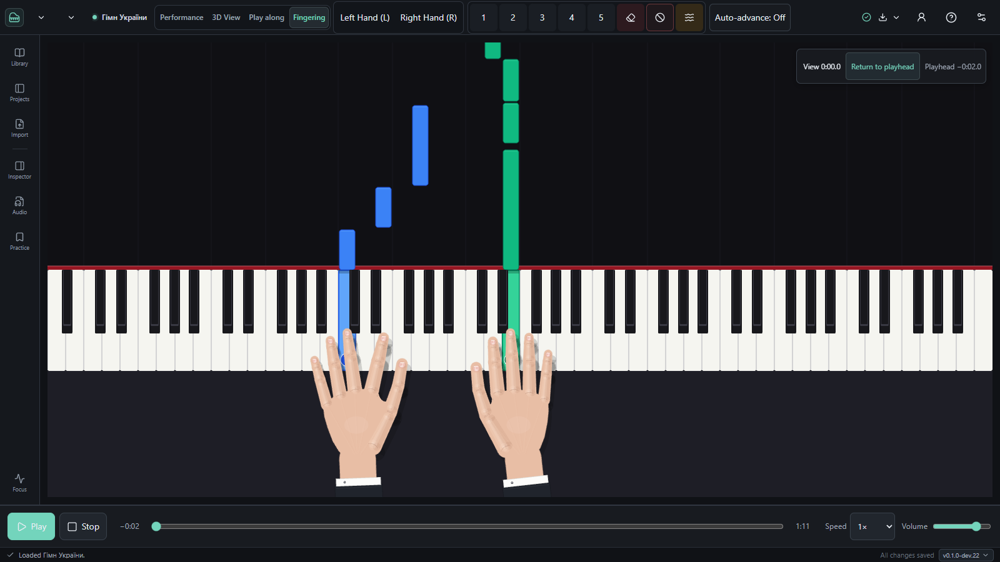
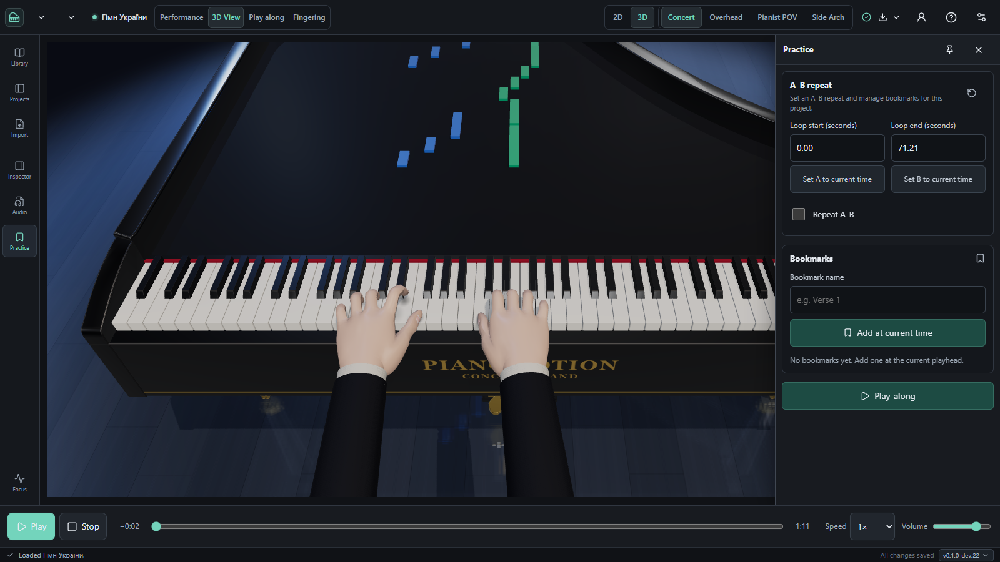
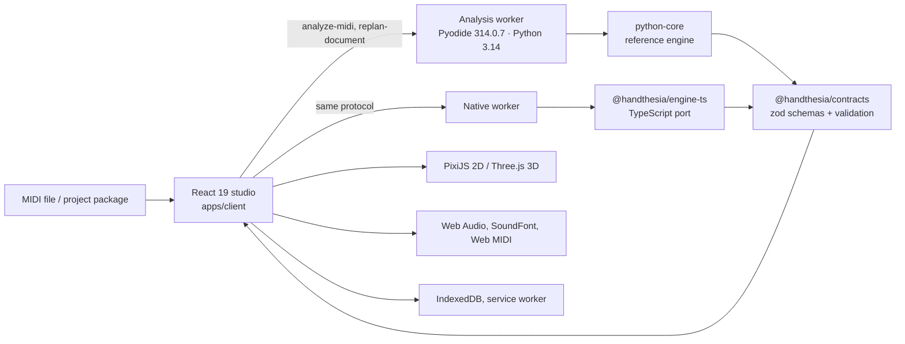

# PianoMotion Studio

[](https://github.com/shafranek-js/pianomotion-studio/actions/workflows/verify.yml)
[](https://github.com/shafranek-js/pianomotion-studio/actions/workflows/deploy-pages.yml)
[](docs/RELEASE_NOTES.md)
[](LICENSE)

**MIDI in — fingering, hand kinematics and a concert stage out, in the browser.**

PianoMotion Studio turns a MIDI file into a performance you can watch, hear, study and edit. Open
a file and the studio splits the score between the hands, plans ergonomic fingering, converts the
plan into physically plausible hand motion, schedules what is actually played (rolled chords, early
releases, sustain/sostenuto/soft pedals) and renders the result as falling notes over an 88-key
keyboard — as a flat PixiJS piano roll or as a lit 3D concert grand with procedural hands.

Everything runs on the device. There is no backend, no upload and no cloud project: the reference
engine is Python 3.14 compiled to WebAssembly and kept in a dedicated Web Worker, the UI is React,
and the built site installs as an offline PWA.

> **Credit.** The automatic fingering planner originates in **[Hand-thesia](https://github.com/V9011N/pygame-piano-animator)**
> by **[V9011N](https://github.com/V9011N)**. Its figure-recognition layer, pianist cost model and
> beam search were taken from that project and rewritten for this codebase — see
> [Credits](#credits) and [How the fingering engine works](#how-the-fingering-engine-works).

[**Open the live studio →**](https://shafranek-js.github.io/pianomotion-studio/)



*Concert camera on the 3D stage: falling notes coloured by hand, a lit floor and the procedural
hands over an 88-key keyboard (v0.1.0-dev.22).*

> **Status: preview.** The current build is `0.1.0-dev.22`. It is developed in public and verified
> by the suites below, but it is not a tagged release; see [Limitations](#limitations).

## Contents

- [What you can do](#what-you-can-do)
- [A closer look](#a-closer-look)
- [How the fingering engine works](#how-the-fingering-engine-works)
- [Architecture](#architecture)
- [Repository layout](#repository-layout)
- [Getting started](#getting-started)
- [npm scripts](#npm-scripts)
- [Tests and CI](#tests-and-ci)
- [Deployment](#deployment)
- [Limitations](#limitations)
- [Documentation](#documentation)
- [Credits](#credits)
- [License](#license)

## What you can do

**Play**

- 88 keys (A0–C8), falling notes coloured by hand, 2D PixiJS piano roll or 3D Three.js scene with
  four cameras: `Concert`, `Overhead`, `Pianist POV` and `Side Arch`.
- Transport with speed 0.25–2×, volume and a negative lead-in of up to 2 s; the scene stays mounted
  when you switch modes, so the position, the Worker and the editor history survive.
- Stage presets `Concert` and `Studio` with brightness, floor-reflection strength and render quality
  in **Inspector → Scene**; preferences are local and never touch the musical revision.

**Edit fingering**

- Hand/finger assignment on the shared scene with hit testing, marquee selection, `1`–`5` for
  fingers, `L`/`R` for hands, `Delete` for unplayable, `G` for glissando, `0` to clear, and
  50 steps of undo/redo.
- **Auto-advance** (off by default) moves to the next note after a finger assignment; confirming the
  same finger does not create a new edit.
- Every edit becomes a revision and replans through the engine worker; a difficulty estimate scores
  the piece from Beginner to Virtuoso.

**Practice**

- **A–B repeat** (minimum 0.1 s) for both normal playback and Play-along, plus named time bookmarks.
- The loop range and bookmarks are saved with the project, restored after a reload, and carried in
  the JSON package bound to the SHA-256 of the source MIDI.

**Hear it**

- Three outputs: the built-in synthesiser, a SoundFont bank, or an external Web MIDI device.
- **MuseScore General v0.2** (SF3, MIT) ships with the studio; custom SF2/SF3 banks up to 1 GiB are
  parsed in a worker and streamed from a Blob.
- Synced recordings (WAV, MP3, OGG, FLAC up to 100 MiB): align a waveform to the MIDI, fine-tune the
  offset in 10 ms steps, and time-stretch with Signalsmith Stretch.
- Pedals CC64/66/67, and the performance follows what the hands physically play.

**Make it yours**

- Pianist profiles: 4 presets (Default, Small Hands, Virtuoso, Left-Hand Lead), 19-bone hand anatomy,
  behaviour weights, JSON import/export. Plans carry the profile and its revision.
- 5 hand skins (realistic, cartoon, gloves, robot, skeleton) with depth-scaled shadows.
- Interface in 6 languages: English, Czech, German, Spanish, Italian and Ukrainian.

**Save, share, export**

- IndexedDB (`handthesia_db` v2) autosave, session recovery and a project list.
- Project package v2 (`.pianomotion.json`) with the original MIDI bytes, stable note IDs, manual
  fingering and the source context; fingered MIDI export for other players.
- Video export to MP4 (H.264/AAC) or WebM (VP9/Opus) through WebCodecs and Mediabunny: 720p, 1080p,
  4K or the current window, at 30 or 60 fps, in a separate worker over a frozen snapshot.
- 163 built-in melodies with search, favourites and difficulty filters.

## A closer look



*Fingering mode on the shared scene: left/right hand, fingers 1–5, clear, unplayable, glissando and
auto-advance (v0.1.0-dev.22).*



*Practice panel over the 3D stage: A–B loop points, repeat toggle, named bookmarks and Play-along
(v0.1.0-dev.22).*

## How the fingering engine works

`python-core/handthesia_core/fingering.py` plans every note the file does not already finger. The
model has three layers:

1. **Figures** (`figures.py`) read the passage the way a pianist does — diatonic scales in 24 keys
   (key detected by a Krumhansl–Kessler profile), chromatic runs, arpeggios, repeated notes, trills,
   octaves, scale-in-thirds and sixths — and suggest the standard (Hanon) fingering with a weight, so
   a suggestion can be overruled by the physical model instead of forcing a result.
2. **A cost model** scores every pair of consecutive notes and every adjacent pair in a chord:
   stretching or cramping away from one white key per finger, crossing over or under, the same finger
   on two keys, the thumb or little finger on black keys, a light bias against 4 and 5, chord fit,
   held keys, hand shifts and the pianist's top speed in m/s.
3. **Physical limits** reject the impossible: a chord plus everything still held must fit the hand
   (`MAX_SPAN` per finger pair), a finger holding a key cannot play another one, and the hand can only
   travel so far between two quick notes unless the shift happens through a thumb crossing.

The search is a **beam search** (`BEAM = 32`) over onset groups for the whole piece. Each candidate
keeps its full history, so keys held from earlier chords are respected; costs are additive and the
best path is recovered by backtracking. The left hand is planned as a right hand on a keyboard
mirrored about D4.

Hand-written fingering is a hard constraint rather than a hint: fixed fingers are kept, and the
`repair` option removes the fewest manual fingers needed to make an impossible chord playable.
`glissando` and `unplayable` are dispositions decided outside the cost model — glissando runs are
removed before planning, unplayable notes are those a five-finger chord cannot reach.

Hands are split in the loader: explicit hand markers and track names (`Right Hand`, `LH`, `bass`,
`treble`) win; two tracks whose average pitches differ by at least 7 semitones are read as upper/lower;
otherwise a second beam search assigns notes per onset group, with a strong but not absolute preference
for the declared track.

Default weights come from two tables in the source: `W_TEXTBOOK`, calibrated against Hanon, and
`LEARNED_W`, 21 overrides tuned on PIG pieces 031–150. A pianist profile scales both. Measured against
the fingering printed in the Hanon book (all 60 exercises, both hands), about 22% of notes differ —
most of what remains is the book deliberately training 4–5 trills and 3-4-3-2 patterns, which this
planner avoids on purpose.

The same engine exists twice: `python-core/handthesia_core` is the reference implementation that runs
in Pyodide, and `packages/engine-ts` is a 1:1 TypeScript port that runs without WebAssembly. Both
serialise to the same versioned contracts, and both are checked against the frozen desktop goldens.

## Architecture



- **One protocol, two engines.** Requests and responses are typed by `@handthesia/contracts`:
  `analyze-midi`, `replan-document`, `export-midi`, `sample-motion` plus lifecycle messages. The
  engine is chosen when the worker is created; the TypeScript engine is the default setting and the
  Python engine remains the reference for parity.
- **Nothing blocks the main thread.** MIDI analysis, hand splitting, fingering, performance
  scheduling and motion sampling all run in a worker; the SoundFont parser, the bank hasher and the
  video-export planner have their own workers.
- **Streamed motion.** Analysis returns the first 4 s of poses; the player streams windows of 200
  poses, keeping ~4 s of lookahead. Each sampled pose is a keyboard-relative skeleton in
  `keyboard-local-inches-v1`, so the renderer only draws.
- **Versioned plans.** Every plan carries `projectId`, `inputRevision`, `profileId`,
  `profileRevision`, `engineVersion` and a request-derived `planId`. A response is applied only if it
  still matches the outstanding request and the current editor state; stale results are dropped.
- **Reject before replace.** An opened package or MIDI is validated and analysed first; only a valid
  result replaces the current project, so a broken file never costs you unsaved edits.

## Repository layout

```text
pianomotion-studio/
├── apps/client/           React 19 SPA: studio shell, player, editor, 2D/3D renderers, audio, PWA
│   ├── public/            tracked static assets (PWA manifest, sw.js, icons, models, textures)
│   └── src/               audio, editor, export, i18n, melodies, midi, player, profiles,
│                          render, render3d, settings, storage, studio, workers
├── packages/
│   ├── contracts/         zod schemas and cross-field validation for every plan and message
│   └── engine-ts/         TypeScript port of the Python engine
├── python-core/           handthesia_core — the reference engine (12 modules)
├── tests/
│   ├── browser/           43 Playwright specs across 7 configurations
│   ├── unit/              Vitest specs that do not live beside their source file
│   └── fixtures/          13 MIDI inputs and 13 golden outputs from the desktop reference
├── tools/                 asset preparation, release build, CI driver, packaging
├── docs/                  implementation notes, verification evidence, licences
├── builtin_melodies/midi/ 163 MIDI files behind the built-in library
├── assets/soundfonts/     MuseScore General v0.2 (SF3, MIT)
└── .github/workflows/     verify.yml (static + build + parallel browser groups), deploy-pages.yml
```

The npm workspace namespace is still `@handthesia/*`; the product name is PianoMotion Studio.

## Getting started

**Requirements**

- **Node.js 24** and the npm that ships with it. CI uses Node 24, and the asset scripts import
  TypeScript sources directly (`tools/prepare-builtin-melodies.mjs` imports
  `packages/engine-ts/src/index.ts`), which needs Node's built-in type stripping.
- Network access on first run: `npm ci` fetches the registry, and the asset preparation fetches the
  Pyodide runtime and three wheels. After that, the studio runs offline.
- Optional, for the Python suite: **Python 3.14** in `python-core/.venv-test`.
- Optional, for browser suites: Chrome or Edge, installed through Playwright.

```bash
git clone https://github.com/shafranek-js/pianomotion-studio.git
cd pianomotion-studio
npm ci
npm run dev
```

`npm run dev` first prepares what is deliberately not in git — a self-hosted Pyodide 314.0.7 runtime
with wheels, the Python core (~21 MiB), the melody catalogue and the SoundFont — then starts Vite and
prints the local URL.

**Production build**

```bash
npm run build     # -> apps/client/dist
npm run preview   # serve the built site
```

The build is not a plain Vite bundle. `tools/build-release.mjs` prepares the generated assets, computes
a content-addressed `buildId`, emits everything under `releases/<buildId>/`, patches the service worker
with that id, writes `offline-manifest.json` (schema 2, SHA-256 per file) and only then leaves a
publishable `dist`.

## npm scripts

| Command | What it does |
|---|---|
| `npm run dev` | Prepare assets and start the Vite dev server. |
| `npm run dev:test` | Start Vite, staging Pyodide, melodies and the SoundFont only if missing; used by Playwright. |
| `npm run build` | Content-addressed production build into `apps/client/dist`. |
| `npm run preview` | Serve the production build. |
| `npm run typecheck` | `tsc` for client, contracts, engine-ts and the tooling config. |
| `npm run lint` | ESLint over configs, tools and sources. |
| `npm run test:unit` | Vitest: contracts, engine, parsers, editor, storage, 3D. |
| `npm run test:browser` | Playwright UI suite. |
| `npm run test:gpu` | WebGL/3D harness specs with a longer timeout. |
| `npm run test:worker` | Worker, streaming and native-parity specs. |
| `npm run test:audio` | Audio, DSP and SoundFont suites. |
| `npm run test:soundfont` | Large and user SoundFont banks. |
| `npm run test:offline` | PWA and offline behaviour against the preview server. |
| `npm run test:media` | MP4/WebM export. |
| `npm run test:browser:all` | All browser groups in order. |
| `npm run test:python` | pytest for `python-core` in `.venv-test`. |
| `npm run test:parity` | Golden parity between the Python engine and the desktop reference. |
| `npm run test:native-parity` | The TypeScript engine against the same goldens. |
| `npm run ci` | The full 8-step pipeline, stopping at the first failure. |
| `npm run archive` | Zip the sources without `node_modules` or test output. |

Individual preparation steps are also available as `prepare:m1:assets`, `prepare:melodies` and
`prepare:soundfont`.

## Tests and CI

| Suite | Files | Scope |
|---|---|---|
| Vitest | 67 files, 639 tests | Contracts, engine, MIDI, SoundFont SF2/SF3, storage, editor, render3d, i18n |
| Playwright | 43 specs, 7 configs | UI, GPU/3D, worker/parity, audio, SoundFont, offline PWA, media |
| pytest | 4 files, 31 tests | Core API, export, motion window, replan |
| Goldens | 13 MIDI + 13 JSON | Desktop reference: notes, fingering, performance, pedals, poses |

Goldens are observations of the desktop reference at a pinned commit, not an independent oracle.
Tolerances are 0.001 s, 0.01 white-key and 0.001 rad. `tests/fixtures/README.md` records their
provenance.

`npm run test:python` needs a Python 3.14 virtual environment at `python-core/.venv-test` (or the path
in `PIANOMOTION_TEST_PYTHON`). One geometry test additionally compares keyboard rectangles with the
desktop `common.Keyboard`; without a sibling `../pygame-piano-animator` checkout that test skips
itself rather than passing silently. CI checks that project out at commit
`f8189c021d9235005fb35faa2c8cfbc09a3768a0`.

Browser suites use the Chromium channel named by `PIANOMOTION_BROWSER_CHANNEL` (`chrome` or `msedge`).
Their `webServer` runs `dev:test`, so the generated assets are staged once and reused; a local
`npm run test:browser` therefore works from a fresh checkout without a separate preparation step.
`npm run test:browser:all` expects a production build first, because the offline group runs against the
preview server. Golden fixtures are compared exactly; changing them is a deliberate parity decision,
not a side effect of a fix.

`.github/workflows/verify.yml` splits verification into independent jobs, so nothing waits behind the
browser suites:

- a Windows **static** job runs Python and goldens, the melody catalogue, typecheck, lint, Vitest and
  native parity once for all channels (the desktop geometry comparison needs the pinned sibling
  checkout);
- an Ubuntu **build** job produces the production `dist` and publishes it as an artifact;
- **browser** jobs run one group each — the UI suite in three shards, plus GPU, worker, audio and
  SoundFont — instead of one sequential two-hour chain, so a failure in one group no longer hides the
  others;
- an **offline** matrix runs the PWA and media groups against the built artifact.

Chrome runs on pull requests; Chrome and Edge run on `main` and manual dispatches, because Edge adds
roughly twenty minutes for the same code. Every job uploads `test-results/` and `playwright-report/`.

## Deployment

The production site is published to GitHub Pages:

**https://shafranek-js.github.io/pianomotion-studio/**

`.github/workflows/deploy-pages.yml` runs typecheck, lint, unit tests and the production build on
every push to `main` and on manual dispatch, then uploads `apps/client/dist`. The deploy job itself
only runs for `main` and only when the repository variable **`PAGES_ENABLED`** is set to `true`; the
build uses the base path `/pianomotion-studio/`.

Publishing is atomic by design. The service worker lives only in production, refuses a manifest whose
`buildId` is not the running one, checks the SHA-256 of every file, and activates a new release only
after its download is complete. `index.html`, the manifest and `sw.js` are served `no-store` while
`releases/<buildId>/*` is immutable, so an update never mixes two builds. Updates require the open
project to be committed, and a reload restores the last autosaved session.

## Limitations

- **Preview software.** `0.1.0-dev.22` has no release tag. Behaviour and UI still change between
  development builds; see [release notes](docs/RELEASE_NOTES.md).
- **Chromium-based browsers are what is verified.** CI exercises Chrome and Edge on Windows.
  Firefox and Safari are untested, and mobile performance is not certified.
- **Large scores are not supported yet.** Files with 10k and 50k notes exceeded the 120 s allowance
  used in testing and are not accepted as supported. The client timeout for one engine job is 180 s.
- **Video export needs WebCodecs.** There is no MediaRecorder fallback: without `VideoEncoder` the
  export is refused with an explanation. Streaming straight to disk needs the File System Access API;
  otherwise output is capped at a 128 MiB blob. Full MP4/WebM exports are not claimed as accepted.
- **SF2/SF3 support is a subset.** Filters, LFOs, modulation patching and exclusive classes are
  ignored, ROM and unknown sample formats are rejected, and sample-rate conversion is not implemented.
- **Web MIDI output is limited.** Note on/off, CC7/64/66/67 only — no SysEx, MIDI 2.0, bank select or
  latency guarantees.
- **The Python↔TypeScript parity gate is still being tightened.** The TypeScript port matches the
  current goldens, but it is younger than the Python engine and its `api.ts` is not type-checked in
  full. Python remains the reference.
- **Weak devices are not measured.** The runtime assets are ~21 MiB and the main chunk is large;
  cold start, memory pressure on low-end hardware and code splitting are open work.
- **Bundled data needs a licence review.** MuseScore General is MIT and its text ships in
  [`docs/licenses`](docs/licenses/MuseScore_General_License.md); the 163 built-in MIDI files have no
  assigned licence, so treat them as not cleared for redistribution.

## Documentation

| Document | Contents |
|---|---|
| [User guide](docs/USER_GUIDE.md) | Interface tour, keyboard shortcuts, profiles |
| [Audio support](docs/AUDIO_SUPPORT.md) | Outputs, SoundFont compatibility, budgets and limits |
| [Studio workspace](docs/STUDIO_WORKSPACE_IMPLEMENTATION.md) | Layout, modes and acceptance details |
| [Dual engine review](docs/DUAL_ENGINE_REVIEW.md) | How the Python and TypeScript engines are kept in step |
| [Release notes](docs/RELEASE_NOTES.md) | Changes in every development build |
| [Audit progress](docs/AUDIT_REPAIR_PROGRESS.md) | Findings, repairs and still-open items |
| [Evidence](docs/evidence/) | Verification records, screenshots and raw test output |
| [Licences](docs/licenses/) | Third-party licence texts |

## Credits

**Fingering planner — [V9011N](https://github.com/V9011N), [Hand-thesia](https://github.com/V9011N/pygame-piano-animator).**
The automatic fingering in this project was not written from scratch. The planner, its figure
recognition and its cost model come from V9011N's desktop piano animator and were rewritten here for a
browser engine:

- **Taken from that project:** the beam search over onset groups, the figure library and its standard
  fingerings, the pianist cost model and its constants, the hand-split heuristics, and the weights
  calibrated against Hanon and tuned on the PIG dataset.
- **Changed here:** the pygame dependency is gone, replaced by numeric keyboard geometry; global
  weights became per-project pianist profiles; plans became deterministic, versioned and serialised
  through zod contracts; the engine was packaged for Pyodide and re-implemented in TypeScript; the
  editor, practice tools, renderers, audio and export around it are new.
- **Still shared:** the desktop project is the frozen parity reference. `verify.yml` checks it out at
  `f8189c02` to compare keyboard geometry, and the goldens in `tests/fixtures/` are its recorded
  output.

`fingering.py` also notes one cost term as following the `pianoplayer` project's economy-of-motion
cost.

**Third-party components.** MuseScore General v0.2 (MIT) as the bundled SoundFont; Pyodide (MPL-2.0),
NumPy (BSD-3-Clause), pretty-midi (MIT) and mido at runtime; PixiJS and Three.js for rendering;
Mediabunny (MPL-2.0) for MP4/WebM muxing; hash-wasm (MIT) for streaming SHA-256; Signalsmith Stretch
(MIT) for time-stretched recordings; React, Radix UI and Lucide for the interface. Notices for the
bundled ones live in [`apps/client/public/notices`](apps/client/public/notices/) and
[`docs/licenses`](docs/licenses/).

## License

PianoMotion Studio is released under a **permissive MIT-style license with an attribution
requirement** — the full text is in [LICENSE](LICENSE). In short:

- **You may** use, copy, modify, merge, publish, distribute, sublicense and sell copies of the code,
  including commercially.
- **Keep the notice.** The copyright line and the license text must stay in copies and substantial
  portions you distribute.
- **Give credit.** If you reuse the code, its algorithms or its ideas in a project you distribute or
  publish, mention **shafranek-js** and link to
  [this repository](https://github.com/shafranek-js/pianomotion-studio) somewhere visible — a README,
  documentation, an about screen or release notes. Private internal use needs no credit.

The license covers this repository's source code and its documentation. It cannot relicense what came
from elsewhere:

- **The fingering engine is derived work.** `python-core/handthesia_core` and its TypeScript port come
  from [V9011N's Hand-thesia](https://github.com/V9011N/pygame-piano-animator), which is published
  without a license. Those parts stay under their author's terms — ask V9011N before redistributing
  them. See [Credits](#credits).
- **Third-party components** keep their own licenses (MuseScore General, Pyodide, NumPy, PixiJS,
  Three.js, Mediabunny and others); notices are in
  [`apps/client/public/notices`](apps/client/public/notices/) and [`docs/licenses`](docs/licenses/).
- **Bundled media is not relicensed.** The MIDI library in `builtin_melodies/`, the hand textures and
  the models in `apps/client/public/` have no recorded provenance and are not cleared for
  redistribution.

Because of the added attribution clause this is not an OSI-approved license, and GitHub will detect it
as a custom license rather than MIT. If you prefer machine-recognised terms, dropping the second
condition turns it into plain MIT.
