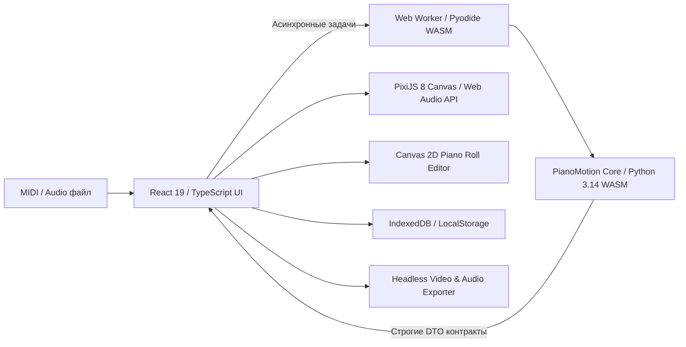

# PianoMotion Studio

Интерактивная веб-студия визуализации фортепианного исполнения, процедурной 3D-кинематики рук, расчёта эргономичной аппликатуры и синхронизации аудио.

Разработано как полностью автономное веб-приложение (Single Page Application + Web Workers + WebAssembly) без серверных зависимостей, работающее локально на устройстве пользователя.

---

## Возможности

- **Математический расчёт аппликатуры**: Алгоритм динамического программирования с многофакторным штрафом за растяжку, вертикальные переходы, скрещивание рук, физическую скорость и анатомические особенности пианиста.
- **Процедурная кинематика рук**: Обратная кинематика (IK) для 23 анатомических костей каждой руки, автоматическое скрещивание рук с динамическим порядком слоёв (`layerOrder`), раскатка широких аккордов и раннее снятие нот на быстрых пассажах.
- **4 процедурных стиля рук**:
  - `cartoon` — телесные мультяшные руки с ногтями, суставами, рукавами и манжетами.
  - `gloves` — белые мультяшные перчатки с прострочкой на тыльной стороне ладони.
  - `robot` — футуристические металлические пластины с шарнирами и тёмными наконечниками.
  - `skeleton` — классический анатомический каркас фаланг и суставов.
  - *Мягкие динамические тени* с затуханием прозрачности и проекцией по высоте руки ($Z$).
- **Скользящий буфер кинематики (Lookahead Buffer)**:
  - Упреждающее сэмплирование поз на 4.0 секунды вперёд в фоновом воркере.
  - Плавная интерполяция между соседними позами на 60 FPS.
  - Физическая верификация касания: гарантированный контакт кончика пальца с нажатой клавишей ($Z \le 0.1$).
- **Рендеринг сцены на PixiJS 8**:
  - 88-клавишная клавиатура (A0–C8) с реалистичной и равноширинной геометрией.
  - Падающие ноты с цветовой кодировкой по рукам (левая — синяя, правая — зелёная) и отсечением невидимых объектов (viewport culling).
  - Красная полоса сукна и фон рабочей зоны рук.
- **Web Audio синтезатор и транспорт**:
  - Полифонический синтезатор с гармоническими обертонами и экспоненциальной огибающей громкости.
  - Полная поддержка педалей: Sustain (CC 64), Sostenuto (CC 66), Soft (CC 67).
  - Точный планировщик событий lookahead на часах AudioContext без дрифта времени.
  - Регулировка скорости (0.25x – 2.0x), громкости и отрицательного затакта (lead-in до -2.0 с).
- **Интерактивный редактор Piano Roll (HTML5 Canvas 2D)**:
  - Горизонтальный пиано-ролл с поддержкой масштабирования (40–600 px/с) и панорамирования.
  - Пошаговый ввод аппликатуры (Sequential Step Entry).
  - История правок с неограниченным Undo/Redo (до 50 шагов).
  - Анализ эргономики и сложности произведения (шкалы от Beginner до Virtuoso).
- **Анатомические профили пианиста**:
  - Регулировка длин фаланг (mc1–5, pp1–5, mp2–5, dp1–5) и ширины запястья.
  - Настройки кинематического поведения (гладкость, скрещивание, раскатка, избегание чёрных клавиш).
  - Пресеты: *Default*, *Small Hands (детские/небольшие руки)*, *Virtuoso (большой охват)*, *Left-Hand Lead*.
- **Синхронизация с внешними аудиозаписями**:
  - Загрузка и декодирование аудио в форматах WAV, MP3, OGG, FLAC (до 100 МБ).
  - Генерация 5-миллисекундного пикового вейвформа (`WaveformCanvas`).
  - Тонкий сдвиг смещения (10 мс шаг при зажатом Shift) для идеального совмещения с MIDI.
- **Экспорт видео и звука (1080p, 720p, 4K, Window)**:
  - Покадровый headless-рендеринг в скрытом PixiJS Canvas.
  - Запись видеопотока через MediaRecorder (WebM / MP4).
  - Мастер-аудио рендерер с экспортом в 16-bit PCM RIFF WAV с пиковой нормализацией до -1 dBFS (0.89).
- **Progressive Web App (PWA) и полная автономность**:
  - Установка как отдельное настольное или мобильное приложение (`manifest.webmanifest`).
  - Двухслойный Service Worker (`pianomotion-shell-v1` и `pianomotion-pyodide-v1`).
  - Локальное хранение в IndexedDB (`handthesia_db` v2) с автосохранением сессий и защитой от переполнения квоты.
  - Безопасность: защита от path traversal, prototype pollution и строгий CSP.

---

## Архитектура

Приложение построено по модульной шинной архитектуре:



---

## Структура проекта

```text
web/
├── apps/
│   └── client/                # Главное React-приложение
│       ├── src/
│       │   ├── audio/         # Web Audio синтезатор, транспорт, синхронизация
│       │   ├── editor/        # Canvas 2D пиано-ролл, команды, история, сложность
│       │   ├── export/        # Видеоэкспортёр, офлайн аудио-рендерер, WAV кодировщик
│       │   ├── player/        # Контроллер воспроизведения и плеер
│       │   ├── profiles/      # Анатомические профили и параметры пианиста
│       │   ├── pwa/           # Регистрация и управление Service Worker
│       │   ├── render/        # PixiJS 8: клавиши, ноты, руки, скины, тени
│       │   ├── settings/      # Настройки приложения
│       │   ├── storage/       # IndexedDB v2, валидация файлов, пакетный экспорт
│       │   └── workers/       # Pyodide Web Worker клиент и обработчики
│       ├── public/            # PWA манифест, иконки, Pyodide WASM рантайм, фикстуры
│       └── dist/              # Готовая production-сборка
├── packages/
│   └── contracts/             # Строгие DTO схемы и Zod-валидаторы (@handthesia/contracts)
├── python-core/               # Численное ядро для WebAssembly (handthesia_core)
├── tests/
│   ├── browser/               # 28 Playwright Chromium тестов
│   ├── unit/                  # 295 Vitest unit-тестов
│   └── fixtures/              # Эталонные фикстуры и валидационные данные
├── tools/                     # Скрипты сборки, упаковки рантайма и CI
├── docs/                      # Техническая документация, отчёты и спецификации
├── package.json               # Корневой npm workspaces манифест
└── vitest.config.ts / playwright.config.ts
```

---

## Запуск и разработка

### Требования
- **Node.js** версии 20+ (рекомендуется LTS 22+).
- **npm** версии 10+.

### Установка зависимостей
```bash
npm ci
```

### Запуск dev-сервера
```bash
npm run dev
```
Сервер будет доступен по адресу: **`http://localhost:5173`** (или `http://127.0.0.1:5175`).

---

## Тестирование и верификация

Проект покрыт автоматическими тестами:

```bash
# Проверка типов TypeScript:
npm run typecheck

# Линтинг кода (ESLint):
npm run lint

# Запуск полного набора unit-тестов (295 тестов):
npm run test:unit

# Запуск браузерных тестов (Playwright):
npm run test:browser

# Полный автоматический CI-пайплайн:
npm run ci
```

---

## Сборка и упаковка

### Сборка production-бандла
```bash
npm run build
```
Собранные статические файлы будут помещены в директорию `apps/client/dist/`.

### Создание автономного zip-архива
```bash
npm run archive
```
Формирует чистый архив `handthesia-web.zip` в корне проекта (без `node_modules` и временных файлов), готовый для переноса и запуска на любом сервере или машине.
